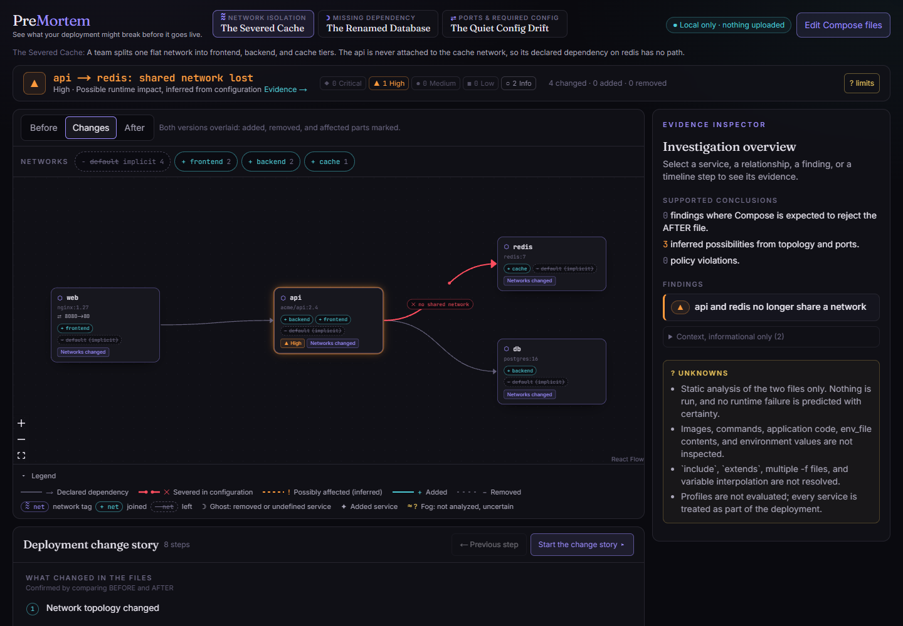
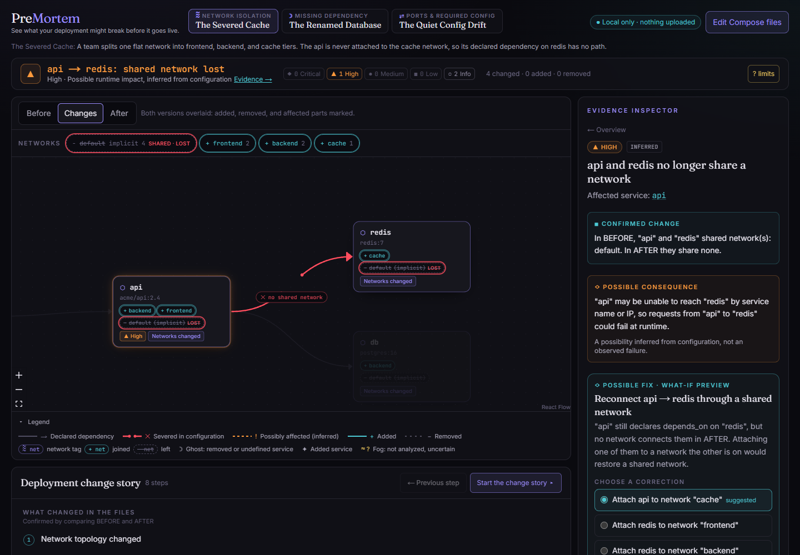
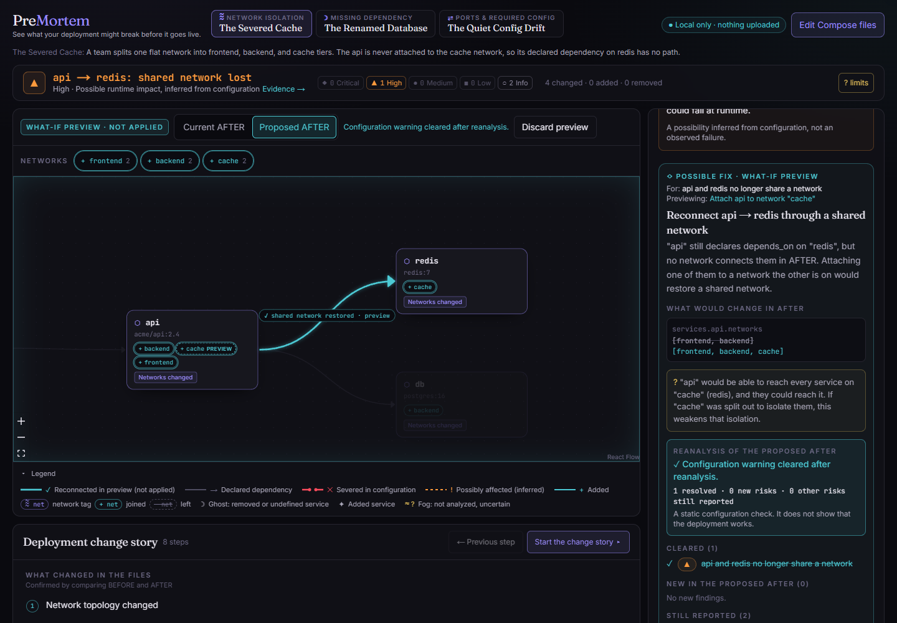
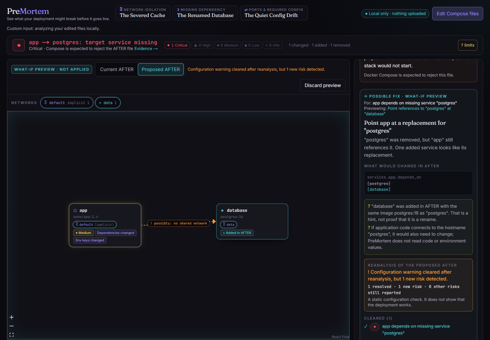

# PreMortem

**See what your deployment might break before it goes live.**

PreMortem compares the BEFORE and AFTER versions of a Docker Compose file and shows, as an interactive "haunted infrastructure" graph, which relationships a change may break. Every warning is backed by evidence from the two files. It also separates what *changed* from what that change *might cause*. Built for Kiroween 2026.

> **Notice:** PreMortem is static analysis of two Compose files. It does not run your services, and it does not guarantee that a deployment is safe or will work. A clean result means no *supported* risk was detected, nothing more.



## The problem

Compose diffs are easy to approve and hard to reason about. Moving a service to a new network, renaming a service, or dropping a published port looks harmless in a diff but can break service-to-service traffic. PreMortem reads the diff the way Docker Compose does and turns it into specific, explainable findings.

## Try the three scenarios

Open the app and pick a scenario at the top. Each demonstrates a different kind of risk:

| Scenario | What changed | What PreMortem reports |
| --- | --- | --- |
| **The Severed Cache** | One flat network split into `frontend`, `backend`, `cache`; `api` was never attached to `cache` | `api → redis: shared network lost` (high, inferred), shown as a severed edge with the lost `default` network marked |
| **The Renamed Database** | `postgres` renamed to `database`, but `app` and `worker` still depend on `postgres` | `app, worker → postgres: target service missing` (critical: Compose is expected to reject the file), with `postgres` drawn as a ghost |
| **The Quiet Config Drift** | A port dropped, another moved, a debug port opened to all interfaces, required variables removed | Two policy findings and three port findings. No broken edges are drawn, because host ports are not service-to-service links |

## How the comparison works

1. **Parse locally.** Both files are parsed as YAML 1.2 data in the browser, with size, alias, and duplicate-key limits. Nothing is executed. Environment *values* are never stored; only whether a variable is declared.
2. **Normalize with Compose semantics.** Services join the implicit `default` network unless they list `networks`. Networks are compared by their real Docker name (`name:`, `external:`). `network_mode: service:X` inherits X's networks. Published ports are host access, not container-to-container connectivity.
3. **Run focused rules** on the pair:
   - `network-lost`: two services shared a network in BEFORE and share none in AFTER.
   - `dependency-unreachable`: a declared dependency in AFTER has no shared network. `depends_on` orders startup; it does not connect containers.
   - `dependency-dangling`: `depends_on`, `links`, or `network_mode` points at a service that no longer exists (with a rename hint).
   - `network-undefined`: a service uses an undeclared network.
   - Ports: removed or changed host ports, changed container ports, loopback-to-all-interfaces exposure.
   - `env-required-removed`: a variable your optional policy requires was dropped.
4. **Show the evidence.** The graph overlays BEFORE and AFTER on one stable layout, with Before, Changes, and After views. The verdict names the top risk by service. The Evidence Inspector shows the before/after evidence, the reason, the affected relationships, and confidence with an explicit list of what cannot be determined. The *Deployment change story* walks through the file changes first, then what they might break.

### Confirmed change vs. inferred risk

Every finding has two separate parts:

- **Confirmed change:** a fact read from the files ("In BEFORE, api and redis shared `default`. In AFTER they share none.").
- **Possible consequence:** what that *might* cause, always phrased as a possibility ("api may be unable to reach redis by service name").

Each finding also states its basis:

- **Compose validation:** Docker Compose is expected to reject the file (for example, a dependency on an undefined service).
- **Inferred:** a likely runtime effect, judged from configuration only.
- **Your policy:** flagged because your policy requires it.

Unsupported constructs are shown as labeled "fog", never as failures.



## What-if Fix Preview

For two supported finding types, PreMortem can preview a possible correction:

- **Lost shared network:** attach one service to a network the other is on (for example, `api` joins `cache`). The panel discloses that this widens network access and may weaken isolation.
- **Renamed dependency:** point references to a removed service at an added service with the same image or build context. This is treated as a hint, not proof: you must confirm the target before previewing.

Previewing builds a proposed copy of AFTER in memory and **reanalyzes it with the same engine**. It shows which findings cleared, which remain, and which are new. A warning counts as cleared only if the engine no longer reports it, and the wording is limited to "Configuration warning cleared after reanalysis". The graph shows restored relationships on the same layout, with a Current/Proposed toggle. Discard returns to the current state. **Apply to AFTER editor** needs a second confirmation, changes only AFTER, and can be undone once.

Patches are minimal text edits: comments, quoting, and unrelated lines stay byte-identical, and each patch is re-parsed and verified. PreMortem declines to patch files that use `include`, `extends`, YAML anchors or merge keys, interpolation, or anything else it cannot edit reliably, and explains why. It never invents values for ports or required variables.



A preview can also reveal a *new* risk. Renaming `postgres` to a `database` that sits on another network clears the missing-service error, but reanalysis reports `app → database: no shared network`, and the verdict says so.



## Privacy and safety

- All analysis runs in your browser tab. Compose files are never uploaded; the deployed site is static.
- PreMortem never executes YAML, scripts, or Docker commands.
- Environment values are not read into reports. Evidence, diffs, and errors pass through redaction (URL credentials, secret-like keys, long tokens).

## Run it

Requires Node.js 20.9 or later.

```bash
npm install
npm run dev            # http://localhost:3000
npm test               # unit tests (Vitest)
npm run typecheck      # TypeScript strict
npm run build          # production build (static)
```

Browser checks and the accessibility audit run against a production server and use an installed Microsoft Edge by default (`PM_BROWSER_CHANNEL=chrome` for Chrome):

```bash
npm run build
npx next start -p 3200          # in a second terminal
npm run smoke                   # UI checks + What-if Fix Preview end-to-end
npm run a11y                    # axe-core, WCAG 2.1 A/AA, 8 UI states
```

`npm run validate:docker` checks the example files with real Docker Compose (`docker compose config`, plus a DNS test showing that `depends_on` does not connect services on different networks). It needs Docker and is meant for CI; see `.github/workflows/compose-validation.yml`. The app itself never uses Docker.

## Deploy to Vercel

1. Import the repository in Vercel. It detects Next.js automatically.
2. Keep the defaults: build command `npm run build`, install command `npm install`, Node.js 20 or 22.
3. No environment variables, database, or secrets are needed.

## Supported Compose features and limits

**Analyzed:** services; `networks` (list or map), the implicit `default`, `name:`, `external:`; `network_mode` (`service:X` resolved; host, none, bridge, and container are marked "not analyzed"); `ports` (short and long syntax, host IP, IPv6, protocols, ranges); `depends_on` (list or map, `required`); `links`; `environment` keys (list or map) and `env_file` names; volumes; YAML anchors and merge keys.

**Not resolved (shown as unknowns):** `include`, `extends`, multiple `-f` files, `${VAR}` interpolation, and profiles (every service is assumed to run).

**Never inspected:** images, commands, application code, `env_file` contents, environment values, host firewalls, or what actually runs.

PreMortem reports configuration evidence and possible consequences. It cannot tell whether your application actually talks to a service, and it does not predict runtime failures with certainty.

## How Kiro helped build this

PreMortem was built with Kiro across six milestones, each reviewed and approved by the author before the next. The `.kiro/` folder is the record:

- [`.kiro/specs/`](.kiro/specs/): requirements, design, and tasks per milestone ([index](.kiro/specs/README.md))
- [`.kiro/decisions/decisions.md`](.kiro/decisions/decisions.md): architecture and product decisions with reasons
- [`.kiro/KIRO_USAGE.md`](.kiro/KIRO_USAGE.md): what Kiro did, which bugs it found, and which Kiro features were and were not used

More detail is in [`docs/ARCHITECTURE.md`](docs/ARCHITECTURE.md) and [`docs/RELEASE.md`](docs/RELEASE.md).

## License

[MIT](LICENSE). Third-party licenses: [THIRD_PARTY_NOTICES.md](THIRD_PARTY_NOTICES.md).
